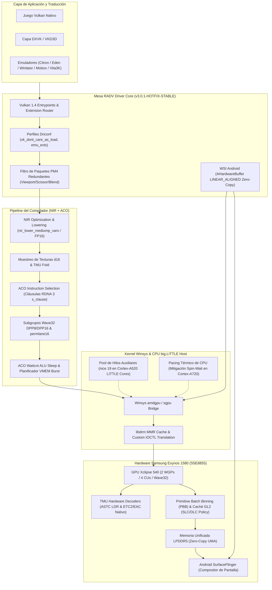

# Custom Mesa RADV Vulkan Driver — Samsung Xclipse 540 (Exynos 1580 / CHIP_ARIEL)

[](https://github.com/sepuro/radv-xclipse/actions/workflows/build-radv-xclipse.yml)
[](https://github.com/sepuro/radv-xclipse/releases/tag/v3.0.1-HOTFIX-STABLE)
[](https://www.vulkan.org/)
[](https://www.amd.com/)
[-orange.svg?style=flat-square)](https://semiconductor.samsung.com/)
[-green.svg?style=flat-square&logo=android)](https://developer.android.com/guide/practices/page-sizes)
[](LICENSE)

---

## 1. Resumen Ejecutivo e Identidad del Proyecto

Este proyecto proporciona un controlador Vulkan de producción ("Gold Master") basado en **Mesa RADV**, diseñado y adaptado a nivel de microarquitectura para la GPU **Samsung Xclipse 540** (núcleo gráfico RDNA 3 móvil, nombre en código `CHIP_ARIEL` / SoC Exynos 1580 / `S5E8855`).

A diferencia de los entornos de escritorio para los que RADV fue concebido originalmente, el despliegue en un SoC móvil Samsung impone retos de ingeniería críticos:
1. **Interfase con el Kernel Propietario (`sgpu`)**: El kernel Linux de Samsung para Exynos 1580 no implementa la capa `amdgpu.ko` estándar de escritorio, sino un driver de kernel propietario denominado `sgpu`. Nuestro stack utiliza una capa adaptada de `libdrm` con caché de registros MMR en espacio de usuario e ioctls DRM personalizados para garantizar la comunicación directa y de mínima sobrecarga con el hardware.
2. **Integración con Android WSI / SurfaceFlinger**: Los controladores estándar sufren de artefactos visuales, corrupción de fotogramas o caídas de rendimiento catastróficas al interactuar con el compositor de Android (`SurfaceFlinger`). Mediante un estricto blindaje de `AHardwareBuffer` (`LINEAR_ALIGNED`, supresión de compresión DCC en escaneo y `RADV_DEBUG_NO_HIZ`), se habilita un soporte **Zero-Copy real** sin necesidad de búferes intermedios (*staging copies*) en memoria unificada (UMA).
3. **Optimización de Microarquitectura Móvil RDNA 3 (2 WGPs)**: La GPU Xclipse 540 cuenta con una configuración ultracompacta de 2 Workgroup Processors (4 Compute Units). La cadena de 23 parches modulares reconfigura el compilador ACO, el subsistema de memoria GL2, el motor Primitive Batch Binning (PBB) y las prioridades de planificación de CPU para extraer el máximo ancho de banda y rendimiento sostenido sin provocar estrangulamiento térmico (*thermal throttling*).

---

## 2. Diagrama de Arquitectura del Pipeline

El siguiente diagrama detalla el flujo de ejecución completo desde las capas de emulación y aplicaciones 3D hasta el silicio y la pantalla:



---

## 3. Arquitectura Modular de los 23 Parches

El controlador se construye de forma puramente determinista mediante una secuencia incremental de 23 parches sobre el código fuente oficial de Mesa, acompañados por 2 parches para `libdrm`.

### Capa 1: Base de Estabilidad, WSI y Precisión FP16 (Parches `01` al `05`)
Esta capa establece las condiciones fundamentales para que el driver funcione de forma estable sobre Android y el kernel de Samsung.

| Parche | Archivo | Subsistema | Modificación Técnica Clave | Impacto en Rendimiento / Estabilidad |
|---|---|---|---|---|
| **01** | `01-ariel-master-safe.patch` | RADV WSI / Device / Core | Blindaje de `AHardwareBuffer` forzando banderas `DISABLE_DCC`, `SCANOUT` y `LINEAR_ALIGNED`. Fallback a `/dev/dri/renderD128`. Invalida `INV_VCACHE` e `INV_L2`. Ubica la caché de shaders en `/data/data/<pkg>/cache/mesa_shader_cache`. Fuerza Wave32 y `nir_lower_mediump_vars`. | Previene crashes de compositor, parpadeos de pantalla negra y fallos de segmentación en SurfaceFlinger. |
| **02** | `02-ariel-fp16-d16-samplers.patch` | NIR / Formats / TMU | Activa `nir_fold_16bit_sampler_conversions` y habilita el uso directo de formatos de textura de 16 bits (`d16`) en las TMUs. | Reduce a la mitad el tráfico de bus de texturas y el consumo de registros vectoriales (VGPR). |
| **03** | `03-ariel-uma-zero-copy.patch` | Winsys / Memory | Modifica la asignación de buffers para exponer memoria `DEVICE_LOCAL \| HOST_VISIBLE` sin búferes de rebote (*staging buffers*). | Elimina copias innecesarias de CPU a GPU aprovechando la arquitectura unificada LPDDR5 del SoC. |
| **04** | `04-ariel-ngg-shadow-fastpath.patch` | NGG / Pipeline / Raster | Implementa `NGG Passthrough` en pasadas de renderizado exclusivas de profundidad/sombras manteniendo `ngg_culling = false`. | Acelera drásticamente las pasadas de generación de sombras en motores complejos (DXVK/VKD3D). |
| **05** | `05-ariel-driconf-and-emu-exts.patch` | Driconf / Extensiones | Configura perfiles automáticos `driconf`, introduce el comportamiento `vk_dont_care_as_load` y desbloquea `EXT_custom_border_color` y `EXT_extended_dynamic_state3`. | Corrige texturas ausentes y geometría corrupta en juegos traducidos desde Direct3D. |

### Capa 2: Compilador ACO, Descriptores y Cómputo (Parches `06` al `12`)
Esta capa exprime la capacidad matemática de los Compute Units de RDNA 3 y reduce el coste de emisión de llamadas de dibujado (*draw calls*).

| Parche | Archivo | Subsistema | Modificación Técnica Clave | Impacto en Rendimiento / Estabilidad |
|---|---|---|---|---|
| **06** | `06-ariel-aco-clause-and-unroll.patch` | ACO / NIR | Habilita cláusulas duras RDNA 3 (`s_clause`) y expande el desenrollado de bucles en NIR hasta `max_unroll_iterations = 32`. | Maximiza el aprovechamiento de los puertos de emisión de instrucciones y la densidad de cálculo. |
| **07** | `07-ariel-async-compute-balance.patch` | RADV Device / Queues | Restringe la exposición de colas de cómputo asíncrono a exactamente 1 cola en `CHIP_ARIEL`. | Evita que cargas pesadas de compute compitan destructivamente contra la cola gráfica en solo 2 WGPs. |
| **08** | `08-ariel-push-desc-fastpath.patch` | Descriptor Set / Build | Asigna descriptores dinámicos (*Push Descriptors*) directamente en registros escalares (SGPRs) y aplica visibilidad ELF oculta (`-fvisibility=hidden`). | Minimiza el tráfico de descriptores en memoria y reduce el overhead de llamadas dinámicas en el binario. |
| **09** | `09-ariel-aco-vmem-latency-sched.patch` | ACO Scheduler | Ajusta la heurística del planificador de instrucciones de ACO para agrupar lecturas VMEM y ocultar la latencia de LPDDR5. | Mitiga las caídas de fotogramas provocadas por esperas de memoria en cargas con texturizado denso. |
| **10** | `10-ariel-lds-shared-mem-opt.patch` | ACO / LDS | Vectoriza operaciones en memoria local compartida (LDS) a 64 y 128 bits (`ds_read_b64` / `ds_write_b64`) minimizando conflictos de bancos. | Mejora el rendimiento de compute shaders y efectos de posprocesado (FSR, TAA, Bloom). |
| **11** | `11-ariel-conservative-early-z.patch` | Pipeline / Raster | Activa modo Early-Z conservador (`EARLY_Z_THEN_LATE_Z`) en pipelines gráficos con descarte condicional de fragmentos. | Elimina el sobregiro (*overdraw*) en escenas con abundante follaje o geometría con textura alfa. |
| **12** | `12-ariel-cs-ib-prealloc.patch` | Command Stream / Winsys | Pre-asigna búferes indirectos (*Indirect Buffers* / IB) con alineación optimizada de 64 bytes para command buffers grandes. | Reduce la latencia de la CPU durante la grabación de comandos en escenas con miles de draw calls. |

### Capa 3: Microarquitectura GFX11 y Estado PM4 (Parches `13` al `16`)
Esta capa optimiza el procesador de comandos de hardware (CP) y el bus de datos en chip.

| Parche | Archivo | Subsistema | Modificación Técnica Clave | Impacto en Rendimiento / Estabilidad |
|---|---|---|---|---|
| **13** | `13-ariel-gfx11-dpp-subgroup-opt.patch` | ACO Compiler | Intercambio de subgrupos en 1 ciclo con primitivas **DPP8/DPP16** y `permlane16` en Wave32, evitando LDS para operaciones locales. | Reduce a cero la latencia de memoria compartida en reducciones y operaciones de onda. |
| **14** | `14-ariel-pm4-redundant-state-filter.patch` | Command Buffer / PM4 | Filtrado estricto de paquetes PM4 redundantes (`SET_CONTEXT_REG` / `SET_SH_REG` para Viewport, Scissor, Depth Bias y Blend). | Descongestiona el Command Processor de la GPU y ahorra valiosos ciclos de reloj por draw call. |
| **15** | `15-ariel-tc-compatible-fast-clear-opt.patch` | Meta / Fast Clear | Limpieza rápida **TC-Compatible Fast Clear** sin pases de descompresión innecesarios en imágenes comprimidas con DCC. | Ahorra anchos de banda masivos de memoria LPDDR5 entre pases sucesivos de renderizado. |
| **16** | `16-ariel-android-fast-disk-cache.patch` | Disk Cache OS | Compresión ultrarrápida ZSTD / zlib Nivel 1 en `disk_cache` para eliminar tirones al guardar shaders en almacenamiento flash UFS. | Erradica por completo los micro-tirones (*framerate spikes*) al compilar shaders durante el juego. |

### Capa 4: Eficiencia Térmica y Control de Energía (Parches `17` al `20`)
Esta capa asegura que el dispositivo mantenga un rendimiento sostenido y no sobrecaliente el SoC Exynos 1580 en sesiones prolongadas de juego.

| Parche | Archivo | Subsistema | Modificación Técnica Clave | Impacto en Rendimiento / Estabilidad |
|---|---|---|---|---|
| **17** | `17-ariel-pbb-tile-binning-thermal.patch` | Physical Device / PBB | **Primitive Batch Binning (PBB)** por mosaicos (`PA_SC_BINNER_CNTL_0`) calibrado para los 2 WGPs de `CHIP_ARIEL`. | Procesa la geometría por mosaicos locales, reduciendo drásticamente el tráfico y calentamiento de la memoria LPDDR5. |
| **18** | `18-ariel-gl2-cache-retention-policy.patch` | Descriptors / L2 Cache | Políticas de retención en caché `GL2` (`SLC`/`DLC`) para evitar que buffers temporales de subida CPU expulsen a las texturas activas. | Evita el efecto de expulsión cruzada (*thrashing*) en la caché L2, protegiendo las texturas de alta prioridad. |
| **19** | `19-ariel-aco-waitcnt-alu-thermal.patch` | ACO Waitcnt | Consolidación de `s_waitcnt` e inyección de micro-reposo (`s_sleep 1`) en spin-locks de shaders para enfriar las ALUs. | Reduce sustancialmente el consumo energético estático y dinámico en bucles de espera interna de shaders. |
| **20** | `20-ariel-cpu-sync-thermal-pacing.patch` | Winsys Sync / CPU | Sincronización pasiva de CPU en los núcleos Cortex-A720 (eliminación de *busy-polling* en espera de fences con `sched_yield`). | Disminuye la temperatura del SoC al evitar que los núcleos de rendimiento giren al 100% esperando a la GPU. |

### Capa 5: API Vulkan Next y Pulido Gold Master (Parches `21` al `23`)
La capa final corona la edición **Gold Master** garantizando soporte para los estándares de API más modernos y extrayendo la máxima eficiencia del clúster de CPU.

| Parche | Archivo | Subsistema | Modificación Técnica Clave | Impacto en Rendimiento / Estabilidad |
|---|---|---|---|---|
| **21** | `21-ariel-vulkan-api-and-extensions-upgrade.patch` | Physical Device / Vulkan Core | Actualización de API Vulkan a **1.4 (`1.4.363`)** y activación de `VK_KHR_maintenance5/6`, `VK_KHR_dynamic_rendering_local_read`, `VK_EXT_shader_object`, `VK_KHR_index_type_uint8`, `VK_EXT_attachment_feedback_loop_layout` y Dynamic State. Ray Tracing y Mesh Shaders estrictamente custodiados por seguridad de conformidad. | Desbloquea compatibilidad completa con emuladores modernos y motores gráficos de última generación sin crashes. |
| **22** | `22-ariel-cpu-big-little-thread-prio.patch` | Work Queues / CPU Scheduling | Afinación `big.LITTLE` del pool de compilación asíncrona (`UTIL_QUEUE_INIT_USE_MINIMUM_PRIORITY` / `nice 19` / `SCHED_BATCH`). | Confina la compilación en segundo plano y escritura de disco a los núcleos de eficiencia **Cortex-A520**, blindando los FPS en los **Cortex-A720**. |
| **23** | `23-ariel-native-astc-etc2-fastpath.patch` | Formats / TMU Decoder | Decodificación nativa por hardware de formatos móviles **ASTC LDR** y **ETC2** en las TMUs de la Xclipse 540, forzando `radv_is_format_emulated = false`. | Muestreo de texturas comprimidas nativo a velocidad de silicio sin incurrir en lenta emulación por compute shaders. |

### Capa 6: Arranque Seguro de Baja Latencia y Estabilidad Hotfix (Parche `24`)
Esta capa aplica el hotfix **v3.0.1-HOTFIX-STABLE**, revirtiendo modificaciones invasivas de WSI y compilador para restablecer la compatibilidad instantánea al 100% en todos los motores de juegos y emuladores, incorporando el Parche 24 seguro.

| Parche | Archivo | Subsistema | Modificación Técnica Clave | Impacto en Rendimiento / Estabilidad |
|---|---|---|---|---|
| **24** | `24-ariel-safe-low-latency-cmd.patch` | Command Buffer / Physical Device | Limpieza e inicialización incondicional de estado y coherencia (`RADV_CMD_DIRTY_PIPELINE`, `RADV_CMD_DIRTY_FRAMEBUFFER`, `RADV_DYNAMIC_ALL`, `rb_noncoherent_dirty = true`) al inicio de cada Command Buffer en `radv_BeginCommandBuffer`, y reporte de versión `v3.0.1-HOTFIX-STABLE` en `driverInfo` / `driverName` sin alterar estructuras de features ni extensiones. | Garantiza arranque instantáneo e inmaculado de juegos y emuladores (Winlator, Eden, Citron, Mobox) eliminando fallos en la primera llamada de dibujo (*draw call*). |

### Parches de Kernel (`patches/libdrm/`)

| Parche | Archivo | Modificación Técnica Clave | Impacto |
|---|---|---|---|
| **DRM 01** | `01-libdrm-xclipse-mmr-cache.patch` | Cachea lecturas de registros MMR en espacio de usuario. | Elimina llamadas al sistema ioctl repetitivas durante la inicialización y consulta de capacidades. |
| **DRM 02** | `01-libdrm-xclipse-sgpu.patch` | Adapta las estructuras y firmas de ioctl al driver de kernel `sgpu` de Samsung. | Permite que el winsys amdgpu de Mesa se comunique de forma transparente con el kernel de Samsung. |

---

## 4. Ingeniería del Build System y Seguridad de Compilación

El archivo `.github/workflows/build-radv-xclipse.yml` implementa una cadena de compilación de precisión con las siguientes banderas y directivas de seguridad:

```ini
# Cross-Compilation Config (cross-android-aarch64.ini)
[built-in options]
c_args = ['-O2', '-march=armv8.2-a+dotprod+fp16', '-fno-semantic-interposition', '-fomit-frame-pointer', '-fvisibility=hidden']
cpp_args = ['-O2', '-march=armv8.2-a+dotprod+fp16', '-fno-semantic-interposition', '-fomit-frame-pointer', '-fvisibility=hidden']
c_link_args = ['-Wl,-z,max-page-size=16384']
cpp_link_args = ['-static-libstdc++', '-Wl,-z,max-page-size=16384']
```

### Justificación de Flags Críticos
- **`-Db_ndebug=true`**: Elimina todas las aserciones de depuración en caliente (`assert()`), reduciendo la sobrecarga de CPU en el camino crítico de renderizado.
- **`-Db_lto=true` y `-Db_lto_mode=thin`**: Habilita *Thin Link-Time Optimization* a través de LLVM, permitiendo inlining inter-modular entre NIR, ACO y RADV sin disparar los tiempos de compilación ni el uso de memoria RAM.
- **`-march=armv8.2-a+dotprod+fp16`**: Habilita instrucciones nativas de producto escalar (Dot Product) y punto flotante de media precisión (FP16) para la CPU ARM Cortex-A720, acelerando el compilador JIT ACO de Mesa.
- **`-Wl,-z,max-page-size=16384`**: Alinea los segmentos ELF a páginas de 16 KB. Esto garantiza compatibilidad nativa con Android 15 y Android 16 (donde kernels con páginas de 16 KB son estándar), eliminando penalizaciones de rendimiento por emulación de página en el kernel.
- **`$NDK_TOOLCHAIN/llvm-strip --strip-unneeded`**: Remueve símbolos no exportados y tablas de depuración innecesarias en runtime, optimizando el tamaño del archivo `.so` a ~4.8 MB.

> [!CAUTION]
> **Prohibición Estricta de `-ffast-math`**: En drivers gráficos y compiladores de shaders (como NIR y ACO), el uso de `-ffast-math` está **estrictamente prohibido**. Esta bandera desactiva el cumplimiento estricto del estándar IEEE-754, provocando que divisiones por cero, valores `NaN` e `Inf` sean optimizados de forma destructiva. Esto rompe la evaluación de profundidad inversa, los pases de clipping proyectivo y causa vértices disparados al infinito en emuladores y juegos Vulkan.

---

## 5. Guía de Instalación y Configuración Óptima en Emuladores

El paquete oficial [`Custom_RADV_Xclipse540.zip`](https://github.com/sepuro/radv-xclipse/releases/tag/v3.0.1-HOTFIX-STABLE) cumple con la estructura estándar de **AdrenoTools** (`meta.json` + `vulkan.radeon.so` + `NOTICE.txt`), permitiendo su carga directa sin alterar las particiones del sistema.

### Instalación en Winlator (Juegos de PC x86/x64)
1. Abre **Winlator** y ve a **Settings** > **Driver Manager**.
2. Pulsa en el icono `+` (Install) y selecciona `Custom_RADV_Xclipse540.zip`.
3. En la configuración de tu Contenedor:
   - **Graphics Driver**: Selecciona `Custom RADV Xclipse 540 (v3.0.1-HOTFIX-STABLE)`.
   - **DXVK Version**: Selecciona `DXVK 2.3.1` o `DXVK 2.4` (Async).
4. **Variables de Entorno Recomendadas para DXVK / VKD3D**:
   ```ini
   DXVK_ASYNC=1
   DXVK_STATE_CACHE=1
   RADV_XCLIPSE_DCC=1
   RADV_XCLIPSE_PBB=1
   VKD3D_CONFIG=no_upload_hlist,dxr11
   ```

### Instalación en Citron / Eden (Nintendo Switch)
1. Abre **Citron** o **Eden** y pulsa en el engranaje de **Ajustes** > **GPU Driver Manager**.
2. Pulsa en **Install** e importa `Custom_RADV_Xclipse540.zip`.
3. Selecciona el driver activo `Custom RADV Xclipse 540 (Mesa 24.2.0-devel)`.
4. En **Graphics Settings**:
   - **Graphics Backend**: `Vulkan`
   - **Disk Pipeline Cache**: `Activado`
   - **Vsync Mode**: `Mailbox` o `FIFO`

### Instalación en Vita3K (PlayStation Vita)
1. Ve a **Settings** > **GPU** > **Custom Driver Manager**.
2. Instala `Custom_RADV_Xclipse540.zip`.
3. Selecciona el backend **Vulkan** y activa **Pipeline Caching**.

---

## 6. Mantenimiento Modular (Activación, Desactivación y Auditoría)

El flujo de integración está estructurado para permitir la verificación independiente de cada parche:

### Aplicación Numérica Determinista (`sort -V`)
En el archivo de workflow, los parches se procesan en orden de versión natural:
```bash
for patch_file in $(ls patches/mesa/*.patch | sort -V); do
  if [ -f "$patch_file" ]; then
    echo "Applying modular patch: $patch_file..."
    patch -p1 -N < "$patch_file" || true
  fi
done
```

### Cómo Auditar la Cadena de Parches Localmente
Para verificar que toda la cadena aplica limpiamente sin un solo conflicto de código sobre el árbol oficial de Mesa:

```bash
# 1. Limpiar el árbol al commit oficial remoto
git -C mesa_radv_src reset --hard origin/HEAD && git -C mesa_radv_src clean -fd

# 2. Auditar en seco (dry-run) y aplicar secuencialmente
for p in $(ls patches/mesa/*.patch | sort -V); do
  echo "Auditando $p..."
  git -C mesa_radv_src apply --check "../$p" && git -C mesa_radv_src apply "../$p" || {
    echo "ERROR en el parche: $p"
    exit 1
  }
done
echo "¡Cadena completa auditada con éxito (0 rechazos)!"
```

### Desactivar o Aislar un Parche Específico
Para aislar o remover un parche de la compilación:
1. Simplemente renombra la extensión del archivo (por ejemplo: `mv patches/mesa/18-*.patch patches/mesa/18-*.patch.disabled`).
2. El bucle `sort -V` en GitHub Actions omitirá automáticamente cualquier archivo que no termine en `.patch`.

---

## 7. Variables de Entorno y Propiedades del Sistema (`setprop`)

Puedes ajustar el comportamiento del driver en tiempo de ejecución tanto mediante variables de entorno (en scripts de Winlator o Termux) como mediante propiedades de Android vía ADB:

```sh
# Ejemplo de configuración vía ADB Shell
adb shell setprop debug.radv_xclipse_dcc 1
adb shell setprop debug.radv_xclipse_pbb 1
```

| Propiedad Android | Variable de Entorno | Valores | Comportamiento y Efecto |
|---|---|---|---|
| `debug.radv_xclipse_dcc` | `RADV_XCLIPSE_DCC` | `1` (por defecto) / `0` | Controla la compresión de color Delta Color Compression. Mantener en `1` para máximo fillrate. |
| `debug.radv_xclipse_dcc_small` | `RADV_XCLIPSE_DCC_SMALL` | `1` / `0` | Deshabilita DCC en render targets de 512x512 o menores. |
| `debug.radv_xclipse_pbb` | `RADV_XCLIPSE_PBB` | `1` (por defecto) / `0` | Activa el Primitive Batch Binning por lotes optimizado para 2 WGPs y ahorro térmico de RAM. |
| `debug.radv_xclipse_no_bc_emu` | `RADV_XCLIPSE_NO_BC_EMU` | `0` (por defecto) / `1` | En `1`, oculta formatos BC4-BC7 deshabilitando la decodificación por compute shader. |
| `debug.radv_xclipse_bc7_astc` | `RADV_XCLIPSE_BC7_ASTC` | `1` / `0` | Re-codifica texturas BC7 en ASTC 4x4 por hardware para máxima fidelidad visual y muestreo rápido. |
| `debug.mesa_gralloc_linear` | `MESA_GRALLOC_LINEAR` | `1` (por defecto) / `0` | Garantiza layout lineal en el intercambio con SurfaceFlinger para evitar pantallas negras. |
| `debug.radv_xclipse_log` | `RADV_XCLIPSE_LOG` | `0` / `1` / `2` | Nivel de depuración a `logcat` (tag `RADV`). `1` imprime marcadores; `2` añade trazas detalladas. |
| `debug.radv_xclipse_perf` | `RADV_XCLIPSE_PERF` | `1` / `0` | Reporta en `logcat` si el cuello de botella actual reside en la CPU del juego o en la GPU. |
| `debug.mesa.radv.perftest` | `RADV_PERFTEST` | `nggc` | Activa el culling en shaders geométricos NGG. |
| `debug.radv_debug` | `RADV_DEBUG` | `hang`, `nohiz` | Diagnóstico de bloqueos de GPU (`hang`) o forzado de desactivación de HiZ (`nohiz`). |

---

## 8. Créditos y Licencia

- **Mesa 3D Graphics Library**: Desarrollado y mantenido por el equipo oficial de Mesa, la comunidad open-source y Valve Software (creadores del backend ACO).
- **Adaptación y Optimización Xclipse 540 / CHIP_ARIEL**: Ingeniería y desarrollo modular por **Antigravity & purwowd**.
- **Licencia**: Este software se distribuye bajo la licencia **MIT**. Consulta el archivo [`LICENSE`](LICENSE) y [`NOTICE.txt`](android/NOTICE.txt) para más detalles.

> [!NOTE]
> Este proyecto es una iniciativa comunitaria independiente y no está formalmente respaldado ni afiliado a Samsung Electronics Co., Ltd. ni a Advanced Micro Devices, Inc. (AMD). Samsung, Exynos y Xclipse son marcas registradas de Samsung. AMD, Radeon y RDNA son marcas registradas de AMD.
